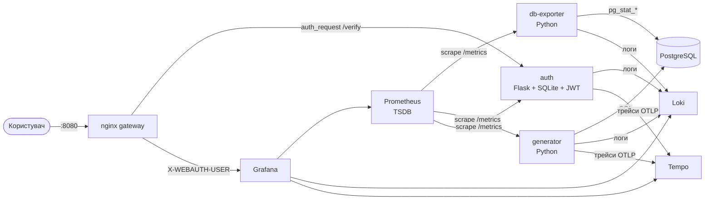

# Information_Systems: моніторинг роботи СУБД (Prometheus + Grafana + Loki + Tempo)

Навчальний проєкт. Система генерує навантаження на PostgreSQL, збирає метрики, логи та трейси
і показує їх у Grafana. Вхід до системи можливий лише для авторизованих користувачів.

## Архітектура



## Відповідність вимогам завдання

| № | Вимога | Реалізація |
|---|--------|------------|
| 0 | СУБД у Docker | PostgreSQL 16 (`postgres` у `docker-compose.yml`), ролі та схема створюються з `db/init/` |
| 1 | Генерація/актуалізація даних | `generator/main.py`: вставки, оновлення, звіти, повільні запити, навмисні помилки |
| 2 | Збір даних: Prometheus | `prometheus/prometheus.yml`; метрики СУБД віддає власний експортер `exporter/main.py` |
| 3 | Time Series Storage | Вбудована TSDB Prometheus (том `prometheus_data`, зберігання 7 днів) |
| 4 | Відображення: Grafana | Дашборд «PostgreSQL: огляд роботи СУБД» підключається автоматично (provisioning) |
| 5 | Логи: Grafana Loki | Python-сервіси надсилають JSON-логи в Loki (`common/obs.py`), панель логів у дашборді |
| 6 | Трейси: Grafana Tempo | OpenTelemetry: кожна операція та SQL-запит генератора, HTTP-запити auth |
| 7 | Авторизація | `auth/auth_service.py` (Flask + SQLite + JWT) + перевірка в nginx через `auth_request` |
| 8 | Docker | Усі сервіси в `docker-compose.yml` |
| 9 | Брокер повідомлень | Не реалізовано: умова це дозволяє. Моніторинг СУБД виконано програмним експортером |

## Швидкий старт

Потрібні Docker та Docker Compose v2.

```bash
cp .env.example .env
# відкрийте .env і замініть усі change-me-... на власні паролі
# секрет для JWT_SECRET можна згенерувати так:
python -c "import secrets; print(secrets.token_hex(32))"

docker compose up -d --build
docker compose ps          # зачекайте, поки gateway, auth, grafana стануть healthy
```

Відкрийте <http://localhost:8080>. Вас перенаправить на сторінку входу.
Логін: `admin`, пароль: значення `ADMIN_PASSWORD` з `.env`.

Зупинка: `docker compose down` (дані збережуться). Повне очищення: `docker compose down -v`.

> Скрипти з `db/init/` виконуються лише при **першому** створенні тому PostgreSQL. Якщо змінили
> паролі в `.env` після першого запуску, виконайте `docker compose down -v` і запустіть заново.

## Що де дивитися

* **Grafana** (<http://localhost:8080>): папка «Моніторинг БД», дашборд «PostgreSQL: огляд роботи СУБД».
  Для Explore (Loki, Tempo) заходьте під `admin`.
* **Prometheus** (<http://localhost:9090>, лише з вашого комп'ютера): розділ Status → Targets, усі
  джерела мають бути `UP`. Приклади запитів:
  * `rate(pg_stat_database_xact_commit_total[1m])` - транзакції за секунду;
  * `histogram_quantile(0.95, sum by (le, operation) (rate(db_operation_duration_seconds_bucket[1m])))`.
* **Loki** (Grafana → Explore → Loki):
  * `{service="generator", level="error"}` - помилки генератора;
  * `{service="auth"} |= "вхід"` - події входу.
* **Tempo** (Grafana → Explore → Tempo → TraceQL):
  * `{ resource.service.name = "generator" && status = error }` - операції, що завершилися помилкою.
  * У логах є поле `trace_id`: у Explore → Loki біля нього з'являється посилання на трейс.
    У трейсі можна перейти до відповідних логів.

## Керування користувачами

Користувачі зберігаються в SQLite (том `auth_data`). Паролі зберігаються як хеш scrypt.

```bash
# отримати токен адміністратора
TOKEN=$(curl -s -X POST http://localhost:8080/auth/api/login \
  -H 'Content-Type: application/json' \
  -d '{"username":"admin","password":"ВАШ_ADMIN_PASSWORD"}' | python -c "import sys,json; print(json.load(sys.stdin)['access_token'])")

# створити користувача (роль viewer або admin, пароль від 8 символів)
curl -X POST http://localhost:8080/auth/api/users \
  -H "Authorization: Bearer $TOKEN" -H 'Content-Type: application/json' \
  -d '{"username":"student","password":"longenough1","role":"viewer"}'
```

Користувач `admin` у Grafana отримує права адміністратора, решта - роль Viewer.

## Як працює авторизація

1. Назовні відкритий лише nginx (порт 8080). Grafana, Loki, Tempo, auth недоступні з хоста напряму.
2. На кожен запит nginx робить підзапит `/verify` до сервісу auth (`auth_request`).
3. Немає дійсного JWT у cookie → 401 → перенаправлення на `/login`.
4. Після входу сервіс видає JWT (HttpOnly cookie, час життя `JWT_TTL_SECONDS`).
5. При успішній перевірці nginx додає заголовок `X-WEBAUTH-USER`, а Grafana (режим auth proxy)
   довіряє йому та створює/впускає користувача. Будь-який такий заголовок від клієнта nginx перезаписує.
6. Захист від підбору паролів: 5 невдалих спроб за хвилину з однієї IP-адреси → тимчасове блокування.

## Структура проєкту

```
.
├── docker-compose.yml
├── .env.example               шаблон налаштувань (.env не комітити)
├── common/obs.py              JSON-логи → Loki, трейси → Tempo (спільний для сервісів)
├── db/init/                   ролі, розширення pg_stat_statements, схема, початкові дані
├── generator/                 генератор навантаження (Python, psycopg2)
├── exporter/                  Prometheus-експортер метрик PostgreSQL
├── auth/                      сервер авторизації (Flask, SQLite, JWT)
├── nginx/default.conf         шлюз з перевіркою авторизації
├── prometheus/prometheus.yml
├── loki/loki-config.yaml
├── tempo/tempo.yaml
└── grafana/
    ├── provisioning/          джерела даних та підключення дашбордів
    └── dashboards/            JSON-дашборд
```

## Обмеження навчальної версії

* Немає HTTPS. Для реального використання поставте перед nginx TLS і встановіть `COOKIE_SECURE=true`.
* Форма входу без CSRF-токена (cookie має `SameSite=Lax`).
* Вбудований Grafana-користувач `admin` має окремий внутрішній пароль (`GRAFANA_ADMIN_PASSWORD`),
  але форма входу Grafana вимкнена: вхід лише через шлюз.
* Версії образів зафіксовані в `docker-compose.yml`; Python-залежності вказані з нижньою межею.
  Після першого успішного запуску можна зафіксувати точні версії (`pip freeze`).
* `pg_stat_statements` віддається лише для топ-10 запитів, щоб не розростався набір часових рядів.

## Ідеї для розвитку

* Додати брокер повідомлень (RabbitMQ або Kafka): генератор публікує події замовлень, окремий
  споживач записує їх у БД, а експортер збирає ще й метрики черги.
* Правила сповіщень (Alertmanager або Grafana Alerting): `pg_up == 0`, зростання `rollback`, довгі запити.
* Тести: автоматична перевірка авторизації та метрик експортера.

## Часті проблеми

* `docker compose up` зупиняється на «Задайте ... у .env»: не створено `.env` або в ньому порожні значення.
* Дашборд порожній одразу після запуску: зачекайте 30-60 секунд, поки накопичаться метрики.
* Сторінка входу показує «Невірний логін або пароль» після зміни `.env`: початкового адміністратора
  створюють один раз у SQLite. Видаліть том: `docker compose down -v`.
* Логи в Loki не з'являються: перевірте `docker compose logs loki` і що `LOKI_URL` заданий у сервісі.
